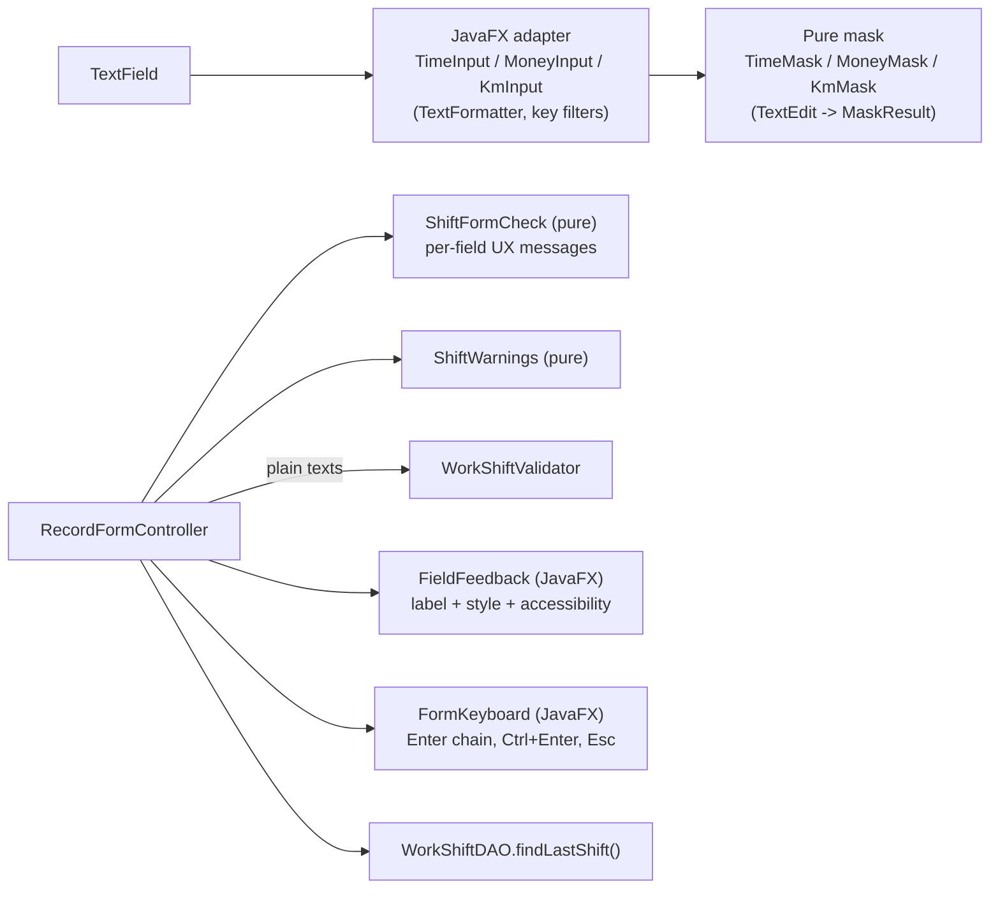

# DriverFin - Architecture

Desktop app (JavaFX 21 / FXML, Java 17, Maven, SQLite through JDBC, OpenPDF, JUnit 5). Package `com.driverfin`.
Requirements for this delivery: `docs/design/UX.md` ("Entrada de dados do turno" and "Dashboard: S-1 a S-4"). Visual rules: `docs/design/UI.md`. Tasks: `docs/TASKS.md`.

## Assumptions (owner, please confirm or correct)
A1. "Touched" field = the user changed its text at least once. Tabbing through an empty field shows no message; saving shows all.
A2. Time and money masks always keep the caret at the end. A partial mouse selection is treated like this: typing appends at the end, deleting removes the last digit. Select-all + typing/deleting starts a new value.
A3. Pasting replaces the whole value of time, money and KM fields (no "paste in the middle").
A4. A single pasted character is treated as typed (JavaFX does not tell paste from typing; see risk R3).
A5. Time hour-only completion: `1` -> `01:00`, `2` -> `02:00`, `0` -> `00:00` (same rule as `8` -> `08:00`).
A6. Time "focus stays in the field" (UX 4, criterion 6) is done by blocking Tab/Enter while the minutes are incomplete. A mouse click elsewhere (for example on Cancelar) is NOT blocked; the message stays visible. Why: trapping focus on every focus loss would make Cancelar unreachable.
A7. KM accepts at most 9 integer digits while typing/pasting (extra digits ignored). Stored KM with more than 1 decimal (old data) is displayed with its decimals (up to 3) so editing never rounds silently.
A8. Closing the form with the window X behaves like Esc (asks "Descartar alterações?" when changed).
A9. Time hours in `turnNote` use one decimal: "Turno atravessa a meia-noite: 8,0 h."
A10. "Turno salvo." / "Turno excluído." are shown in a status label in the dashboard header for 4 seconds.

## Current state (before this delivery)
| Package | Classes | Responsibility |
|---|---|---|
| `com.driverfin` | `Main`, `MainApp` | Start-up: DB init/migration, loads `dashboard.fxml`, creates `DashboardController(dao, dbConn)` |
| `controller` | `DashboardController`, `RecordFormController` | Screens. Dashboard: filters, KPIs, chart, table, backup, PDF, opens the form as a modal `Stage`. Form: reads fields, live calculation, save |
| `dao` | `DatabaseConnection`, `DatabaseInitializer`, `WorkShiftDAO` | SQLite. Money stored as cents (INTEGER), date/time as ISO text (`2024-03-05`, `08:00`) |
| `model` | `WorkShift`, `FinancialSummary` | Shift data and per-shift math (hours, km, gross, net) |
| `service` | `SummaryService` | Totals and averages of a list of shifts |
| `util` | `WorkShiftValidator`, `CurrencyFormat`, `MaintenanceRate`, `ShiftFilter`, `ShiftMetrics`, `PdfReportExporter`, `DatabaseBackup`, `Styles`, `Dialogs` | Pure helpers (validation, formatting, filters, metrics) plus two JavaFX helpers (`Styles`, `Dialogs`) |

Call flow: `MainApp` -> `DashboardController` -> (`WorkShiftDAO`, `SummaryService`, `ShiftFilter`, `CurrencyFormat`, `PdfReportExporter`, `DatabaseBackup`) and opens `RecordFormController.initData(ws, rate, dao)`. The form calls `WorkShiftValidator.validateAndPopulate(...)` with the raw field texts (on every key for the live calculation, and on save), then `dao.save(shift)`.
Tests (150+) are pure JUnit: no JavaFX toolkit is started. `FxmlBindingTest` reads the FXML as text and checks `fx:id` <-> `@FXML` field in both directions and `onAction` handlers.

## What changes in this delivery

### Layers of the form input

1. **Pure masks** (`util`, no JavaFX import): each mask receives a `TextEdit` (old text, replaced range, inserted text: the same information as a JavaFX `TextFormatter.Change`) and returns a `MaskResult` (new full text, caret, optional message). All rules of UX sections 4-6 live here and are unit-tested without the toolkit.
2. **Thin JavaFX adapters** (`util`, one file per mask): build a `TextEdit` from the `Change`, call the mask, write the result back into the `Change` (full-text replace + caret), install key filters that a `Change` cannot see (Delete on money, Tab/Enter block on incomplete time), and format on focus loss. No rules inside; not unit-tested (manual check list in each task).
3. **One converter per kind** feeds the validator and the live calculation: `MoneyMask.displayToPlain("1.234,56") = "1234,56"`, `KmMask.toPlain("12.450,5") = "12450,5"`; time text is already `HH:mm`. `WorkShiftValidator` keeps its format rules (it still rejects `1.000`).
4. **Form-level checks** (`ShiftFormCheck`, pure) produce the exact UX messages per field (empty, incomplete, unreadable, KM final < inicial, notes too long). They run on field exit (touched fields) and on save (all fields). Only when they pass does the controller call the validator. See `docs/adr/0001-form-checks-before-validator.md`.
5. **Validator exposes the field**: `WorkShiftValidator` throws `FieldValidationException(field, message)`, a subclass of `IllegalArgumentException`. Messages are unchanged, so every existing test keeps passing. The controller uses `getField()` as a safety net to put an unexpected validator error under the right field (never a dialog).
6. **Messages under fields**: one `Label` per field (`<field>Error` / `<field>Msg`, see UX 3). `FieldFeedback` sets text, `visible`/`managed`, the style classes (`input-error` on the field; `field-error` / `field-warning` / `field-info` on the label) and `accessibleHelp` on the field. Priority when a field has several messages: ERROR > WARNING > INFO (`FieldMessage.strongest`).

### Error mapping on save (RecordFormController)
1. Build `ShiftFormInput` from the display texts. `errors = ShiftFormCheck.checkAll(input)` (already sorted in Tab order = `ShiftField` declaration order).
2. If not empty: show every error with `FieldFeedback`, focus the first error's field and select its text. Window stays open. No dialog.
3. Else call the validator with plain texts. A `FieldValidationException` is shown under `e.getField()` the same way (safety net). Any other exception from `dao.save` = technical failure = dialog "Erro ao salvar" (as today).
4. `btnSave` disabled while saving; on success `savedShift` is kept and the stage closes.

### Last shift (KM sugerido)
`WorkShiftDAO.findLastShift()`: `SELECT * FROM work_shifts ORDER BY date DESC, time_start DESC, id DESC LIMIT 1`. ISO date and `HH:mm` text sort correctly as text. Called once by `RecordFormController.initData` only when `ws == null`. A `SQLException` is logged and the form opens without a suggestion (the form must not fail because of a hint).

### Dashboard (S-1 to S-4)
- Pure: `SummaryService.forDay(shifts, day, rate)` returns `DaySummary(shiftCount, totals)`; `DashboardTexts` builds every dashboard text (today title, profit with "(prejuízo)", hours, R$/h or "—", "2 turnos hoje", table placeholder, delete confirmation); `MaintenanceRate.format` / `describe` for S-4. All tested with a fixed `LocalDate`, never `LocalDate.now()` inside the pure code.
- `dashboard.fxml` gets `todayCard`, `emptyStateBox`, `lblStatus` and `fx:id`s on the existing sections it must hide (`filtersBar`, `maintBar`, `kpiGrid`, `chartCard`, `tableCard`).
- Shortcuts: `DashboardShortcuts` (JavaFX, new file) installs Scene accelerators Ctrl+N/B/P/F when the scene exists (listener on `tableRecords.sceneProperty()`, so `MainApp` does not change). Enter/Delete are an event filter on `tableRecords` only; Esc is on `searchField` only.
- "Hoje" is recomputed (no DB access) on load, save, delete, rate change and when the window gains focus.

### New and changed files (owner task in brackets)
New pure (`util`): `ShiftField`, `MessageKind`, `FieldMessage`, `FieldError`, `FieldValidationException`, `TextEdit`, `MaskResult`, `FormMessages` [T0]; `TimeMask` [T1]; `MoneyMask` [T2]; `KmMask` [T3]; `ShiftFormInput`, `ShiftFormCheck` [T5a]; `ShiftWarnings` [T8a]; `DashboardTexts` [T9a]. New pure (`model`): `DaySummary` [T9a].
New JavaFX: `util/FieldFocus` [T0]; `util/TimeInput` [T1]; `util/MoneyInput` [T2]; `util/KmInput` [T3]; `controller/FieldFeedback` [T4b]; `controller/FormKeyboard` [T6]; `controller/DashboardShortcuts` [T10].
Changed: `WorkShiftValidator` [T0]; `WorkShiftDAO` [T7a]; `SummaryService`, `MaintenanceRate` [T9a]; `record-form.fxml` [T4a only, later tasks only if listed]; `RecordFormController` [T4a, T4b, T5b, T6, T7b, T8b in sequence]; `dashboard.fxml`, `DashboardController` [T9b, T10, T12 in sequence]; `theme-dark.css`, `UI.md` [T11, ui-designer].
Unchanged: `MainApp`, `WorkShift`, `FinancialSummary`, `CurrencyFormat` (masks do their own formatting with integer math; see "Why").

## Why this design
- **Pure mask + thin adapter**: the rules are many and fiddly (UX tables). Testing them through a real `TextField` needs a running JavaFX toolkit, which this project's tests never start. With `TextEdit -> MaskResult` every row of the UX tables becomes one plain JUnit assertion. The adapter is about 30 lines and only copies data.
- **Full-text replace + caret at end** for time and money: masks that insert `:` or thousands separators move characters around; letting JavaFX apply a partial change and then "fixing" it causes cursor jumps. Replacing the whole text inside the `Change` is the reliable way.
- **Masks format with integer math, not `NumberFormat`**: `1.234,56` is built from a `long` of cents, so there is no locale or non-breaking-space surprise and no rounding. `CurrencyFormat.money` (with "R$") stays the formatter for labels.
- **Form checks before the validator** instead of rewriting validator messages: the validator is covered by many tests that check its texts; the UX messages are about the screen ("Informe a hora de início."). Keeping both avoids breaking those tests, and the validator remains the last gate before the database.
- **All new `fx:id`s added in one task (T4a)**: `FxmlBindingTest` fails whenever an `fx:id` and an `@FXML` field are out of sync, and FXML merges are hard to read. One task adds every node (hidden) and its field; later tasks only write behaviour.

## Error handling
- Field problem: message under the field, never a dialog (form) / message beside the field (maintenance rate).
- Technical failure (DB, file): logged with `java.util.logging` and shown in a `Dialogs.show` dialog, as today.
- `findLastShift` failure: logged; form opens without suggestion.

## Tests
- Pure classes: JUnit 5 in `src/test/java/com/driverfin/util|service|dao`, one test class per new class, named `<Class>Test`. Each UX acceptance row becomes a test case.
- DAO: real SQLite file in `@TempDir`, as in `WorkShiftDAOTest`.
- FXML: `FxmlBindingTest` must keep passing after every task; tasks that add `fx:id`s add the matching `@FXML` fields in the same task.
- JavaFX adapters and controllers: manual check list in the task (run `mvn javafx:run`).

## Known risks and trade-offs
| ID | Risk | Mitigation |
|---|---|---|
| R1 | `TextFormatter` caret: replacing the whole text moves the caret | Adapter sets `change.setRange(0, oldLen)`, `setText(result.text())`, then `selectRange(caret, caret)` from `MaskResult.caret()` |
| R2 | Delete key at the end of the text produces NO `Change` (nothing after the caret), so "Delete zeroes money" cannot be done in the formatter | `MoneyInput` adds a `KEY_PRESSED` event filter for `DELETE` that sets `0,00` and consumes the event |
| R3 | JavaFX does not distinguish paste from typing | Heuristic `TextEdit.isPaste()` = inserted length > 1 (A4). A pasted single digit acts as typed |
| R4 | Select-all on focus: a mouse click resets the selection after the focus event | `FieldFocus.selectAllOnFocus` uses `Platform.runLater(field::selectAll)` on focus gained |
| R5 | `TextArea` and `DatePicker` consume Enter/Esc before Scene accelerators run; DatePicker Esc must close its popup, not the form | `FormKeyboard` uses a Scene `KEY_PRESSED` event **filter** (runs before controls) for Ctrl+Enter and Esc; Esc is ignored while `datePicker.isShowing()`. `btnSave` loses `defaultButton`, `btnCancel` loses `cancelButton` |
| R6 | DatePicker typed text is committed only on Enter/focus loss; garbage text throws in the default converter | `FormKeyboard` commits the editor text before moving focus; T5b sets a converter that returns `null` on bad text, so the check shows "Escolha a data do turno." |
| R7 | Dashboard accelerators need the Scene, which does not exist in `initialize()` | Install from a `sceneProperty()` listener; guard against installing twice |
| R8 | Enter on `TableView` / Delete in `searchField` | Enter/Delete only in an event filter on `tableRecords`; `searchField` gets only Esc |
| R9 | `FxmlBindingTest` breaks when fx:id and field drift | T4a / T9b add nodes and fields together; reviewers run the test |
| R10 | Parallel `java-dev` runs share one working copy: a half-written file of one task breaks `mvn test` of another | Run in parallel only the tasks marked so in `docs/TASKS.md` (separate files); each agent checks with `mvn test -Dtest=<its tests>` first and the full `mvn test` last; if the full run fails only in another task's files, report it instead of fixing it |
| R11 | Old KM values with 2 decimals would be rounded by a 1-decimal display | A7: display keeps stored decimals; typing still allows 1 |
| R12 | Two rule sets (form checks and validator) can drift | Checker messages are UX texts; validator stays the final gate; T5a adds a test that every input accepted by the checker is accepted by the validator |
| R13 | `CurrencyFormat.money` output contains a non-breaking space (`R$ `) | Tests of texts that embed money compare with `CurrencyFormat.money(...)`, not a typed literal |
| R14 | Screen-reader support in JavaFX is limited | Best effort: `Label.setLabelFor`, `accessibleHelp` for messages, `accessibleText` with the full money value. Not automatically testable |
