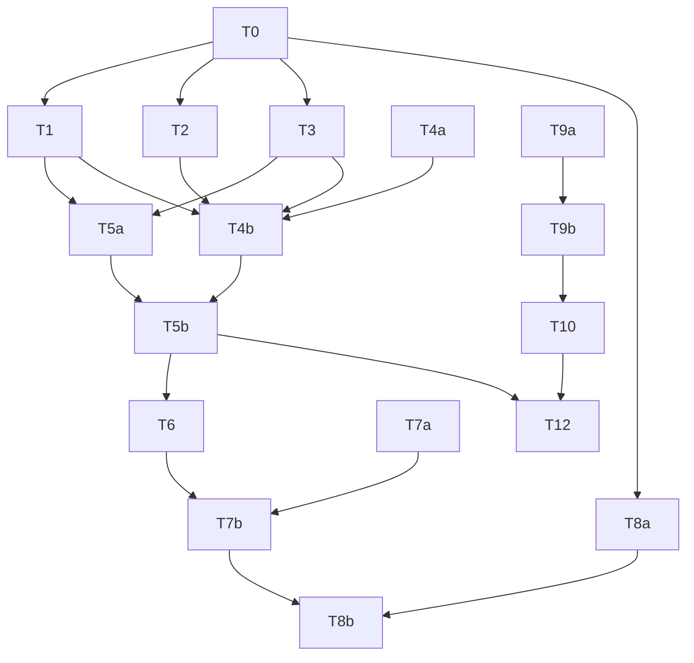

# DriverFin - Tasks (form data entry + dashboard S-1 to S-4)

Source: `docs/design/UX.md` (criteria "F<n>" = form criterion n of UX section 14; "D<n>" = dashboard criterion n of UX dashboard section 8). Design: `docs/ARCHITECTURE.md`.
Build: `mvn test`. Every task ends with the full `mvn test` green (all existing 150+ tests plus the new ones) and `FxmlBindingTest` green.
Rules for every task:
- Only the files listed under "Files" are created or changed. Need another file? Stop and report it.
- Texts: copy them from `FormMessages` / `DashboardTexts` / UX section 12; never retype.
- Pure classes (marked "pure") must not import `javafx.*`.
- The signatures under "Shared interfaces" are a contract: do not rename, do not change parameters. Adding private helpers is fine.

## Changes to the UX task list (and why)
| Change | Why |
|---|---|
| New T0 (shared types + validator field) | T1, T2, T3, T5a, T8a share `TextEdit`, `MaskResult`, `FieldMessage`, `FormMessages`. Writing them first lets those tasks run in parallel without touching the same file |
| Each mask task (T1-T3) also creates its own thin JavaFX adapter file | Keeps T4b to wiring only, and each adapter is in its own file (no conflicts) |
| T4 split into T4a (all FXML nodes + `@FXML` fields) and T4b (wiring) | `FxmlBindingTest` and FXML merges: every new node is added once, in one task |
| T5 split into T5a (pure checks) and T5b (wiring) | Pure checks are testable and can run early |
| T8 split into T8a (pure warnings) and T8b (wiring) | Same reason |
| T9 split into T9a (pure dashboard logic and texts, incl. S-4 texts) and T9b (FXML + wiring) | Pure part runs in parallel with the form block |
| T6: "focus stays in the field" only blocks Tab/Enter, not mouse clicks | Trapping focus on every focus loss makes Cancelar unclickable (ARCHITECTURE A6) |
| New T12 (select saved row + "Turno salvo.") | UX states it (form step 7, state "Sucesso") but no UX task owned it; it needs both blocks done |
| UX "no change in the validator": only the exception type changes | Needed to map errors to fields; rules and messages stay identical (ADR 0001) |

## Shared interfaces (contract, created by T0 unless noted)
All in package `com.driverfin.util` unless noted. All pure except `FieldFocus`.

```java
/** Declaration order = Tab order of the form. "First error" = lowest ordinal. */
public enum ShiftField { DATE, TIME_START, TIME_END, KM_START, KM_END,
    EARN_UBER, EARN_99, EARN_OTHERS, COST_FUEL, COST_FOOD_OTHER, NOTES }

public enum MessageKind {
    ERROR("field-error"), WARNING("field-warning"), INFO("field-info");
    public String styleClass();
}

public record FieldMessage(MessageKind kind, String text) {
    public static FieldMessage error(String text);
    public static FieldMessage warning(String text);
    public static FieldMessage info(String text);
    /** ERROR > WARNING > INFO; if equal kind returns a; null-safe (null when both null). */
    public static FieldMessage strongest(FieldMessage a, FieldMessage b);
}

public record FieldError(ShiftField field, String message) {}

public class FieldValidationException extends IllegalArgumentException {
    public FieldValidationException(ShiftField field, String message);
    public ShiftField getField();
}

/** One edit of a text field, same data as JavaFX TextFormatter.Change: oldText[start, end) replaced by inserted. */
public record TextEdit(String oldText, int start, int end, String inserted) {
    // compact constructor: null oldText/inserted -> ""; 0 <= start <= end <= oldText.length() else IllegalArgumentException
    public boolean isDeletion();   // inserted.isEmpty() && start < end
    public boolean replacesAll();  // !oldText.isEmpty() && start == 0 && end == oldText.length()
    public boolean isPaste();      // inserted.length() > 1
    public String resultText();    // what JavaFX would show without a mask
}

/** Result of a mask. Rejected edit = text equals the old text. message may be null. */
public record MaskResult(String text, int caret, FieldMessage message) {
    public static MaskResult of(String text, FieldMessage message); // caret = text.length()
    public static MaskResult unchanged(String oldText, FieldMessage message);
}

/** Every user-facing text of the form (copied from UX section 12). Only T0 edits this file. */
public final class FormMessages {
    DATE_REQUIRED, TIME_START_REQUIRED, TIME_END_REQUIRED, TIME_INCOMPLETE, TIME_INVALID,
    KM_START_REQUIRED, KM_END_REQUIRED, KM_UNREADABLE, MONEY_UNREADABLE, MONEY_MAX,
    MONEY_COMMA_HINT, MONEY_HINT, KM_SUGGESTED_HINT, EQUAL_TIMES,
    TITLE_NEW, TITLE_EDIT, SUBTITLE, DISCARD_TITLE, DISCARD_TEXT, DISCARD_CONFIRM, DISCARD_KEEP, SAVE_FAILED_TITLE
    // public static final String, values exactly as UX 12 ("Erro ao salvar" for SAVE_FAILED_TITLE)
    public static String kmEndBelowStart(String formattedKmStart); // "O KM final precisa ser maior ou igual ao KM inicial (12.450,0)."
    public static String notesTooLong(int charactersOver);         // "Passou 3 caracteres do limite de 500."
    public static String crossesMidnight(String hours);            // "Turno atravessa a meia-noite: 8,0 h."
    public static String highValue(String formattedMoney);         // "Valor alto: confira se são R$ 5.000,00 mesmo."
    public static String unusualRate(String formattedMoney);       // "Faturamento por hora fora do usual (R$ 3,20/h). Confira as horas e os ganhos."
}

/** JavaFX helper (T0). */
public final class FieldFocus {
    /** On focus gained: Platform.runLater(selectAll). If text equals caretAtEndText, caret at end instead. */
    public static void selectAllOnFocus(javafx.scene.control.TextInputControl field, String caretAtEndText); // null = always select all
}
```

Masks (pure; T1, T2, T3) and their adapters (JavaFX):
```java
public final class TimeMask {                       // T1
    public static MaskResult apply(TextEdit edit);
    /** Exit/Enter: "", unchanged, no message; "0".."2" -> "0H:00"; "08"/"08:" -> "08:00";
        "08:3" -> unchanged + error TIME_INCOMPLETE; "08:30" -> unchanged. */
    public static MaskResult complete(String text);
    /** Exactly "HH:mm", 00:00..23:59. */
    public static boolean isComplete(String text);
}
public final class TimeInput {                      // T1, JavaFX
    /** TextFormatter with TimeMask.apply; on focus lost applies complete(); Tab/Enter consumed while complete() returns an error; messages -> onMessage (null clears). */
    public static void install(TextField field, Consumer<FieldMessage> onMessage);
}

public final class MoneyMask {                      // T2
    public static final long MAX_CENTS = 100_000_000L; // R$ 1.000.000,00
    public static final String ZERO = "0,00";
    public static MaskResult apply(TextEdit edit);
    public static MaskResult paste(String oldText, String pasted); // UX 5 "Colar" rules 1-7
    public static String display(long cents);        // 123456 -> "1.234,56", 0 -> "0,00"
    public static String plain(long cents);          // 123456 -> "1234,56", 0 -> "0,00"
    /** "1.234,56" -> 123456; blank -> 0; anything not in display format -> IllegalArgumentException. */
    public static long parseDisplay(String text);
    public static String displayToPlain(String text); // plain(parseDisplay(text)); THE converter for the validator
    public static long toCents(BigDecimal reais);    // HALF_UP; null -> 0
    public static BigDecimal toReais(long cents);    // scale 2
}
public final class MoneyInput {                     // T2, JavaFX
    /** Sets "0,00", TextFormatter with MoneyMask.apply, DELETE key filter = zero, select-all on focus (caret at end on "0,00"),
        accessibleText = CurrencyFormat.money(value). Transient messages -> onMessage; cleared (null) on next key and on focus lost. */
    public static void install(TextField field, Consumer<FieldMessage> onMessage);
    public static long cents(TextField field);
    public static void setCents(TextField field, long cents);
}

public final class KmMask {                         // T3
    public static final int MAX_INTEGER_DIGITS = 9;
    public static MaskResult apply(TextEdit edit);  // typing filter (caret kept where the user types) + paste (whole value)
    /** Exit: blank unchanged; readable -> display form "12.450,0"; unreadable -> unchanged + error KM_UNREADABLE. */
    public static MaskResult formatOnExit(String text);
    public static String display(double km);        // 12450.0 -> "12.450,0"; 100.55 -> "100,55" (keeps stored decimals, max 3)
    public static String toPlain(String text);      // "12.450,5" -> "12450,5"; blank -> ""; removes dots only
    public static OptionalDouble parse(String text); // display or typing form -> value; empty when blank or unreadable
}
public final class KmInput {                        // T3, JavaFX
    /** TextFormatter with KmMask.apply; on focus lost formatOnExit; select-all on focus; messages -> onMessage. */
    public static void install(TextField field, Consumer<FieldMessage> onMessage);
}
```

Others:
```java
public record ShiftFormInput(LocalDate date, String timeStart, String timeEnd,
                             String kmStart, String kmEnd, String notes) {}            // T5a, util, display texts
public final class ShiftFormCheck {                                                   // T5a
    /** Message for one field, or empty. KM_END includes the "final >= inicial" rule (only when both parse). Money fields -> always empty. */
    public static Optional<FieldError> checkField(ShiftField field, ShiftFormInput input);
    /** All errors, sorted by ShiftField order. */
    public static List<FieldError> checkAll(ShiftFormInput input);
}
public final class ShiftWarnings {                                                    // T8a
    public static final long HIGH_VALUE_CENTS = 500_000L;                             // R$ 5.000,00
    public static Optional<String> turnNote(LocalTime start, LocalTime end);          // end < start: crossesMidnight; equal: EQUAL_TIMES
    public static Optional<String> highValue(long cents);                             // cents >= HIGH_VALUE_CENTS
    public static Optional<String> unusualRate(double hours, BigDecimal gross);       // hours > 0, gross > 0, gross/h < 5.00 or > 300.00
}
// dao (T7a)
public Optional<WorkShift> findLastShift() throws SQLException; // ORDER BY date DESC, time_start DESC, id DESC LIMIT 1
// model (T9a)
public record DaySummary(int shiftCount, FinancialSummary totals) {}
// service (T9a)
public static DaySummary forDay(List<WorkShift> shifts, LocalDate day, BigDecimal maintRate); // shifts with getDate().equals(day)
// util (T9a)
public final class DashboardTexts {
    public static String todayTitle(LocalDate day);             // "HOJE - terça-feira, 10 de novembro"
    public static String profit(BigDecimal net);                // "R$ 182,40" | "-R$ 12,30 (prejuízo)"
    public static String hours(double hours);                   // "8,5 h" | "0 h"
    public static String grossPerHour(DaySummary day);          // "R$ 38,20 / h" | "—" when hours == 0
    public static String shiftCount(int count);                 // "" when < 2 | "2 turnos hoje"
    public static String tablePlaceholder(String searchText);   // "Nenhum turno neste período." | "Nenhum turno encontrado para \"x\"."
    public static String deleteConfirmText(WorkShift ws, BigDecimal maintRate); // UX S-3 text
    public static final String TODAY_EMPTY, TODAY_NEW_BUTTON, EMPTY_TITLE, EMPTY_TEXT, SHORTCUTS_HINT,
        DELETE_TITLE, SAVED, DELETED, MAINT_INVALID, MAINT_HELP; // exact UX texts
}
// util, MaintenanceRate (T9a)
public static String format(BigDecimal rate);   // 2 decimals with comma: 0.3 -> "0,30"
public static String describe(BigDecimal rate); // "R$ 0,25 por km rodado, para pneus, óleo e revisões."
// controller (T5b)
public Optional<WorkShift> getSavedShift();     // RecordFormController; present after a successful save
```

## Dependency map and parallel waves

| Wave | Tasks (parallel inside the wave, different files) |
|---|---|
| 1 | T0, T4a, T7a, T9a, T11 |
| 2 | T1, T2, T3, T8a, T9b |
| 3 | T5a, T4b, T10 |
| 4 | T5b |
| 5 | T6, then T7b, then T8b (same files: sequential) |
| 6 | T12 |
Bottlenecks: `RecordFormController` + `record-form.fxml` are owned in sequence by T4a -> T4b -> T5b -> T6 -> T7b -> T8b. `DashboardController` + `dashboard.fxml` by T9b -> T10 -> T12. Never run two tasks of the same chain at the same time. Parallel runs share one working copy: see ARCHITECTURE R10.

---

## T0 - Shared types, texts and validator field
- Status: TODO | Depends on: - | security: yes (input validation gate) | ui: no
- Files: create `util/ShiftField.java`, `util/MessageKind.java`, `util/FieldMessage.java`, `util/FieldError.java`, `util/FieldValidationException.java`, `util/TextEdit.java`, `util/MaskResult.java`, `util/FormMessages.java`, `util/FieldFocus.java` (JavaFX); change `util/WorkShiftValidator.java`; tests `util/TextEditTest.java`, `util/FieldMessageTest.java`, `util/FormMessagesTest.java`, add cases to `util/WorkShiftValidatorTest.java`.
- Signatures: "Shared interfaces" above.
- Validator: every `throw new IllegalArgumentException(msg)` becomes `throw new FieldValidationException(<field>, msg)` with the SAME message. Field per check: date -> DATE, start/end time -> TIME_START/TIME_END, KM -> KM_START/KM_END, "KM Final não pode ser menor" -> KM_END, Uber/99/Outros/Combustível/Alimentação -> EARN_UBER/EARN_99/EARN_OTHERS/COST_FUEL/COST_FOOD_OTHER, notes -> NOTES. No rule changes.
- Acceptance:
  - `mvn test` green; no existing test file changed except new cases appended to `WorkShiftValidatorTest`.
  - New validator test: for one bad value per field, `assertThrows(FieldValidationException.class, ...).getField()` equals the expected `ShiftField` (11 cases).
  - `TextEditTest`: `new TextEdit("150,00", 0, 6, "5").replacesAll()` true; `new TextEdit("12", 1, 2, "").isDeletion()` true; `isPaste()` true for `"830"`; `resultText()` of `("abc",1,2,"X")` = `"aXc"`; bad range throws.
  - `FieldMessageTest`: `strongest(info, error)` = error; `strongest(null, warning)` = warning; `strongest(null, null)` null; `MessageKind.ERROR.styleClass()` = `"field-error"`.
  - `FormMessagesTest`: each format method returns the UX 12 text for a sample (e.g. `notesTooLong(3)` = `"Passou 3 caracteres do limite de 500."`).
- New concept: custom exception subclass (keeps old `catch (IllegalArgumentException)` working).

## T1 - Time mask (pure) + TimeInput adapter
- Status: TODO | Depends on: T0 | security: no (output still passes the validator) | ui: yes
- Files: create `util/TimeMask.java`, `util/TimeInput.java` (JavaFX), `test/.../util/TimeMaskTest.java`.
- Rules (state = up to 4 digits; display: 0 -> `""`, 1 -> `d`, 2 -> `dd:`, 3 -> `dd:d`, 4 -> `dd:dd`):
  - typed digit: 1st 0-2 kept; 1st 3-9 -> `0d` (`08:`); 2nd after `2` only 0-3; 3rd only 0-5; 5th ignored. `:` typed with 1 digit pads (`1` + `:` -> `01:`), otherwise ignored. Other chars ignored. `replacesAll` + digit starts from empty.
  - deletion: `replacesAll` -> `""`; otherwise remove last digit (`08:` -> `0`, `08:30` -> `08:3`).
  - paste (`isPaste`): with `:` -> hour 1-2 digits, minutes 2 digits; only digits -> first 4: 1-2 digits = hour only (`HH:`), 3 = `H` + `MM`, 4 = `HH` + `MM`; hour > 23 or minute > 59 -> unchanged + error TIME_INVALID; no digits -> unchanged, no message.
- Acceptance (TimeMaskTest, by typing each key through `apply` from `""`): F1 `0800` -> `08:00`; F2 `830` -> `08:30`, `8` -> `08:`, `complete("08:")` = `complete("08")` = `08:00`, `complete("1")` = `01:00`; F3 `24` -> `2`, `08` + `6` -> `08:`; F4 backspace `08:` -> `0`, `08:30` -> `08:3`; F5 paste `8:30`, `830`, `08:30`, `0830` -> `08:30`; paste `25:00` -> unchanged + TIME_INVALID; paste `abc` unchanged; `complete("08:3")` error TIME_INCOMPLETE; `isComplete("23:59")` true, `"24:00"` false; every result's `caret` = text length.
- Manual check (`mvn javafx:run`, after T4b): typing in Hora de início behaves as above; Tab with `08:3` stays in the field with the message.
- New concept: `TextFormatter` and its `UnaryOperator<Change>` filter.

## T2 - Money mask (pure, cents as long) + MoneyInput adapter
- Status: TODO | Depends on: T0 | security: no | ui: yes
- Files: create `util/MoneyMask.java`, `util/MoneyInput.java` (JavaFX), `test/.../util/MoneyMaskTest.java`.
- Rules: UX 5. Typing: digit -> `cents*10+d`; above `MAX_CENTS` -> unchanged + warning MONEY_MAX; `,` or `.` -> unchanged + info MONEY_COMMA_HINT; others ignored silently. Deletion: `replacesAll` -> 0; otherwise `cents/10`. `replacesAll` + digit -> start from 0. Paste -> `paste()`; success replaces the whole value. Display built with integer math (no `NumberFormat`).
- Acceptance (MoneyMaskTest): F8 keys `1..6` -> `0,01`,`0,12`,`1,23`,`12,34`,`123,45`,`1.234,56`; F9 `15000` -> `150,00`; edit `("150,00",0,6,"5")` -> `0,05`; `005` -> `0,05`; F10 backspace `1.234,56` -> `123,45`, backspace on `0,00` -> `0,00`, select-all + delete -> `0,00`; F11 `,` `.` `a` `-` unchanged, `,`/`.` give MONEY_COMMA_HINT; F12 from `999.999,99` any digit unchanged + MONEY_MAX, from `100.000,00` digit `0` gives `1.000.000,00` (equal to the ceiling is allowed); F13 paste `R$ 1.234,56`, `1234,56`, `1.234,56` -> `1.234,56`; `123456` -> `123.456,00`; `150` -> `150,00`; `150,5` -> `150,50`; `12.50` -> `12,50`; `1234.5` -> `1.234,50`; `1.234` -> `1.234,00`; `1.234.567` and `1000000,01` -> unchanged + MONEY_MAX; `1234,567`, `abc`, `-5`, `""` -> unchanged + MONEY_UNREADABLE; F17 `displayToPlain("0,00")` = `"0,00"`, `displayToPlain("1.234,50")` = `"1234,50"` and `WorkShiftValidator` accepts it (populate a shift, assert `1234.50`); `toCents(new BigDecimal("1234.5"))` = 123450; `display(MoneyMask.toCents(x))` round-trips for 0, 0.01, 1000000.00.
- Manual check (after T4b): Delete key zeroes; focusing selects all; caret at end on `0,00`.
- New concept: storing money as an integer number of cents (`long`).

## T3 - KM mask (pure) + KmInput adapter
- Status: TODO | Depends on: T0 | security: no | ui: yes
- Files: create `util/KmMask.java`, `util/KmInput.java` (JavaFX), `test/.../util/KmMaskTest.java`.
- Rules: UX 6. Typing: digits kept, `.` -> `,`, only one `,`, at most 1 digit typed after `,` (existing extra stored decimals stay), max `MAX_INTEGER_DIGITS`, letters/`-` ignored; caret = start + accepted inserted length. Paste replaces the whole value, same reading as money paste but 1 decimal; only digits = whole km.
- Acceptance (KmMaskTest): `formatOnExit("12450")` -> `12.450,0`; `formatOnExit("12450,5")` -> `12.450,5`; typing `.` after `12450` gives `12450,`; second decimal digit ignored; `a`/`-` ignored; paste `12.450,5`, `12450,5`, `12450.5` -> `12450,5` text (editing form), paste `12450` -> `12450`; paste `abc` unchanged + KM_UNREADABLE; `toPlain("12.450,5")` = `"12450,5"` and the validator accepts it; `display(100.55)` = `"100,55"`; `parse("12.450,0")` = 12450.0; `parse("")` empty.
- Manual check (after T4b): leaving KM shows `12.450,0`.

## T4a - Form FXML: every new node and @FXML field (no behaviour)
- Status: TODO | Depends on: - | security: no | ui: yes
- Files: change `view/record-form.fxml`, `controller/RecordFormController.java` (fields only + title constants from UX 12; no logic changes).
- Content (UX 3 and 12): rótulos exactly as UX 12 (no "(HH:mm)", no "(R$)"), subtitle, title texts without emoji; prefix `R$` / suffix `km` Labels (styleClass `input-affix`) beside fields in an HBox; header "VALORES" and `moneyHint` (styleClass `money-hint`, always visible); message labels, hidden (`visible="false" managed="false"`): `timeStartError`, `timeEndError`, `kmStartError`, `kmEndError`, `kmStartHint`, `earnUberMsg`, `earn99Msg`, `earnOthersMsg`, `costFuelMsg`, `costFoodOtherMsg`, `notesError`, `turnNote`, `rateWarn`; legend "* obrigatório"; calc block styleClass `calc-block`, `lblCalcGross` and `lblCalcNet` also get `calc-value-large`; buttons `btnCancel` "_Cancelar", `btnSave` "_Salvar Turno" with `mnemonicParsing="true"`, and REMOVE `defaultButton` / `cancelButton`; `@FXML` fields for every new fx:id and for `btnSave`, `btnCancel`; `labelFor` on each rótulo; prompt texts from UX 12.
- Acceptance: `mvn test` green including `FxmlBindingTest`; grep shows no `defaultButton` in `record-form.fxml`; manual: form opens with the new texts and no message visible.
- Note: `FxmlBindingTest` allowlist for `btnSave`/`btnCancel` may stay; do not edit the test.

## T4b - Wire masks, converter and live calculation
- Status: TODO | Depends on: T1, T2, T3, T4a | security: no | ui: yes
- Files: change `controller/RecordFormController.java`; create `controller/FieldFeedback.java` (JavaFX).
- `FieldFeedback` (package-private is fine): `void show(Label message, Control field, FieldMessage m)` (null clears: hides label, removes `input-error`, clears `accessibleHelp`); adds `input-error` only for ERROR; label style class = `m.kind().styleClass()`.
- Controller: `TimeInput/MoneyInput/KmInput.install` on the fields with `m -> feedback.show(<label>, field, m)`; `readShiftFromFields` passes `MoneyMask.displayToPlain` / `KmMask.toPlain` texts to the validator; `initData` fills edit mode with `MoneyMask.setCents(..., toCents(...))`, `KmMask.display(...)`, `LocalTime` text; new shift: `datePicker` = today, focus `timeStartField` (`Platform.runLater`); edit: title `TITLE_EDIT`, focus first field.
- Acceptance: `mvn test` green; manual (`mvn javafx:run`): F1, F8, F9 (selection), F16 (moneyHint visible, gross/profit update every key), F17 (save `0,00` and `1.234,50`, then edit shows `1.234,50`), F18 (KM display), F20.

## T5a - Form checks (pure)
- Status: TODO | Depends on: T1, T3 | security: no | ui: no
- Files: create `util/ShiftFormInput.java`, `util/ShiftFormCheck.java`, `test/.../util/ShiftFormCheckTest.java`.
- Messages (FormMessages): DATE null -> DATE_REQUIRED; time blank -> TIME_START_REQUIRED / TIME_END_REQUIRED; time after `TimeMask.complete` still with error -> TIME_INCOMPLETE; not `isComplete` -> TIME_INVALID; KM blank -> KM_*_REQUIRED; KM `parse` empty -> KM_UNREADABLE; KM end < start -> `kmEndBelowStart(KmMask.display(start))` on KM_END; notes > 500 -> `notesTooLong(length - 500)`.
- Acceptance (ShiftFormCheckTest): all-empty input gives 5 errors in order DATE, TIME_START, TIME_END, KM_START, KM_END; `08:3` -> TIME_INCOMPLETE; KM `12.450,0` / `12.000,0` -> exact message with `(12.450,0)`; equal KM -> no error; notes 503 chars -> "Passou 3 caracteres do limite de 500."; drift guard: 5 valid sample inputs that pass `checkAll` also pass `WorkShiftValidator` (with plain texts and `0,00` money).

## T5b - Field errors in the form, save flow
- Status: TODO | Depends on: T4b, T5a | security: no | ui: yes
- Files: change `controller/RecordFormController.java`.
- Behaviour: per-field `touched` (text changed by user); on focus lost of a touched field run `checkField` (also KM_END when leaving `kmStartField` with `kmEndField` not blank); message clears while typing as soon as `checkField` is empty; save flow = ARCHITECTURE "Error mapping on save" (no validation dialog; `btnSave` disabled while saving; technical failure dialog title `SAVE_FAILED_TITLE`); DatePicker converter returns null on unreadable text; `getSavedShift()`.
- Acceptance: `mvn test` green; manual: F6 (with T1), F18 (KM final message on exit without saving), F22 (new form untouched + Salvar: 4 messages on times and KM, focus on `timeStartField` with text selected, no dialog; clear the date too: 5 messages, focus on `datePicker`), F24 (each message readable without color).

## T6 - Form keyboard: Enter chain, Ctrl+Enter, Esc + discard, Alt+S/C, Tab order
- Status: TODO | Depends on: T5b | security: no | ui: yes
- Files: create `controller/FormKeyboard.java` (JavaFX); change `controller/RecordFormController.java`; `view/record-form.fxml` only if node order must change for Tab order.
- `FormKeyboard.install(Scene scene, List<Control> enterChain, Control saveOnEnter, Runnable save, Runnable cancel, BooleanSupplier datePopupShowing)`: Enter on chain item -> next (DatePicker: commit editor text first); Enter on `costFoodOtherField` -> save; Scene event filter: Ctrl+Enter -> save (also in `notesArea`), Esc -> cancel unless the date popup is showing. Cancel: if snapshot of all field texts differs from the one taken at end of `initData`, ask with `DISCARD_*` (default button "Continuar editando"); window X (`onCloseRequest`) does the same.
- Acceptance: `mvn test` green; manual F21, F23; Enter in `notesArea` inserts a line break; Enter on `btnCancel` focused activates it; Alt+S saves.
- New concept: event filter vs event handler (capturing phase).

## T7a - DAO: last shift
- Status: TODO | Depends on: - | security: yes (SQL) | ui: no
- Files: change `dao/WorkShiftDAO.java`; add tests to `test/.../dao/WorkShiftDAOTest.java`.
- Acceptance (`@TempDir` SQLite like existing tests): empty DB -> `Optional.empty()`; two dates -> later date; same date `08:00` and `14:00` -> the `14:00` one even if inserted first; same date and time -> higher id; shift crossing midnight (22:00-02:00 on day D) vs shift on day D 10:00 -> the 22:00 one. Constant SQL, no string concatenation.

## T7b - KM inicial suggested in the form
- Status: TODO | Depends on: T6, T7a | security: no | ui: yes
- Files: change `controller/RecordFormController.java`.
- Behaviour: UX 7; new shift only; `KmMask.display(last.getKmEnd())`, text selected, `kmStartHint` = KM_SUGGESTED_HINT (`field-info`), hint hidden on first user change; `SQLException` logged, no suggestion. The suggestion does not count as "changed" for the discard question.
- Acceptance: manual F19 (new: suggested + hint + typing replaces; first ever shift: empty; edit: no suggestion); open new form and Esc without typing closes without asking.

## T8a - Warnings (pure)
- Status: TODO | Depends on: T0 | security: no | ui: no
- Files: create `util/ShiftWarnings.java`, `test/.../util/ShiftWarningsTest.java`.
- Acceptance: `turnNote(22:00, 06:00)` = "Turno atravessa a meia-noite: 8,0 h."; `turnNote(08:00, 08:00)` = EQUAL_TIMES; `turnNote(08:00, 17:00)` empty; `highValue(499_999)` empty, `highValue(500_000)` = `highValue(CurrencyFormat.money(5000.00))` text; `unusualRate(10, 49.99)` present (R$ 5,00/h boundary: `unusualRate(10, 50.00)` empty), `unusualRate(1, 300.00)` empty, `unusualRate(1, 300.01)` present, hours 0 or gross 0 -> empty. Compare money texts with `CurrencyFormat` output (ARCHITECTURE R13).

## T8b - Warnings in the form
- Status: TODO | Depends on: T7b, T8a | security: no | ui: yes
- Files: change `controller/RecordFormController.java`.
- Behaviour: `turnNote` from both times when complete; per money field warning `highValue(cents)` combined with transient mask message via `FieldMessage.strongest`; `rateWarn` from the live calculation; warnings never block save.
- Acceptance: manual F7, F14, F15; save works with all warnings visible.

## T9a - Dashboard pure logic and texts (S-1, S-2, S-3 texts, S-4)
- Status: TODO | Depends on: - | security: no | ui: no
- Files: create `model/DaySummary.java`, `util/DashboardTexts.java`, `test/.../util/DashboardTextsTest.java`; change `service/SummaryService.java` (+ `forDay`), `util/MaintenanceRate.java` (+ `format`, `describe`); add tests to `SummaryServiceTest.java`, `MaintenanceRateTest.java`.
- Acceptance: `forDay` with 2 shifts today + 1 yesterday -> count 2 and summed totals equal to `calculate` on the two; shift 22:00-02:00 counts on its start date; no shift -> count 0; `todayTitle(2026-11-10)` = "HOJE - terça-feira, 10 de novembro"; `profit(-12.30)` = "-R$ 12,30 (prejuízo)" (built from `CurrencyFormat.money(12.30)`); `hours(0)` = "0 h", `hours(8.5)` = "8,5 h"; `grossPerHour` with 0 h = "—"; `shiftCount(1)` = "", `shiftCount(2)` = "2 turnos hoje"; `tablePlaceholder("")` / `("uber")`; `MaintenanceRate.format(0.3)` = "0,30"; `describe(0.25)` = "R$ 0,25 por km rodado, para pneus, óleo e revisões.".

## T9b - Dashboard: todayCard, emptyStateBox, placeholder, status label
- Status: TODO | Depends on: T9a | security: no | ui: yes
- Files: change `view/dashboard.fxml`, `controller/DashboardController.java`.
- FXML: ALL new dashboard nodes for T9b, T10 and T12 are added here, with `@FXML` fields: `todayCard`, `lblTodayTitle`, `todayValuesBox`, `lblTodayProfit`, `lblTodayHours`, `lblTodayGrossPerHour`, `lblTodayShifts`, `lblTodayEmptyText`, `btnTodayNew` (`#handleNewRecord`), `emptyStateBox`, `emptyStateTitle`, `emptyStateText`, `btnEmptyNew` (`#handleNewRecord`), `lblStatus`, `filtersBar`, `maintBar`, `kpiGrid`, `chartCard`, `tableCard`, `lblMaintHelp`, `lblMaintError`, `lblMaintSubtext`, `lblShortcutsHint`. Style classes from UX "Classes novas".
- Behaviour: UX S-1 / S-2 and state table; `showStatus(String)` private helper (4 s, `PauseTransition`); today refreshed on load, save, delete, rate change, window focus.
- Acceptance: `mvn test` green; manual D1-D6, D12.

## T10 - Dashboard shortcuts (S-3) and maintenance bar (S-4)
- Status: TODO | Depends on: T9b | security: no | ui: yes
- Files: create `controller/DashboardShortcuts.java` (JavaFX); change `controller/DashboardController.java`, `view/dashboard.fxml` (texts, tooltips, prompt only).
- `DashboardShortcuts.install(Node anyNodeInScene, Runnable newShift, Runnable backup, Runnable pdf, Runnable focusSearch)` (installs once when the scene appears). Table filter: Enter -> edit selected, Delete -> `handleDelete` with `DashboardTexts.deleteConfirmText` and `DELETE_TITLE`, then select next (or previous) row, focus table, `showStatus(DELETED)`. `searchField` Esc. Maintenance: on focus lost/Enter: valid -> `MaintenanceRate.format`, store, `lblMaintSubtext` = `describe`; invalid -> previous valid value + `lblMaintError` = MAINT_INVALID (no tooltip, no dialog). Focus: `btnEmptyNew` when empty, else `tableRecords`.
- Acceptance: `mvn test` green; manual D7-D11, D13; typing "n" or "b" in `searchField` is not affected.

## T11 - Styles (ui-designer)
- Status: TODO | Depends on: - | security: no | ui: yes
- Files: `src/main/resources/com/driverfin/css/theme-dark.css`, `docs/design/UI.md`.
- Acceptance: every class in UX "Classes novas" exists in the CSS; `mvn test` green (`CssRulesTest`); contrast ratios written in UI.md for `field-error`, `field-warning`, `field-info`, `today-profit`, `shortcut-hint`.

## T12 - After save: select row and "Turno salvo."
- Status: TODO | Depends on: T5b, T10 | security: no | ui: yes
- Files: change `controller/DashboardController.java`.
- Behaviour: after the form closes with `getSavedShift()` present: reload, select and scroll to the row with that id (it may be hidden by the filter: then no selection), focus table, `showStatus(SAVED)`; first saved shift hides `emptyStateBox`.
- Acceptance: manual form step 7, D2; `mvn test` green.
